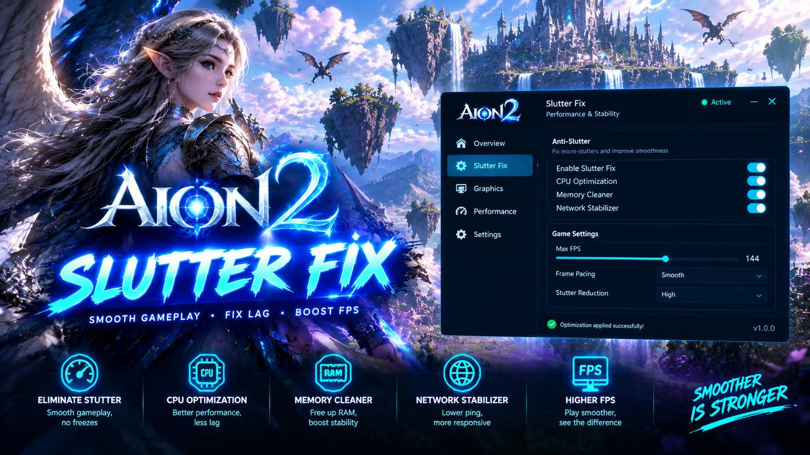

# AION 2 Stutter Fix 2026: FPS Boost & Frame-Time Consistency — Windows 10 & 11

    

---

AION 2 Stutter Fix 2026 is a lightweight Windows utility designed to stabilize frame times and improve overall performance in AION 2 without altering gameplay mechanics. The tool applies targeted graphics presets, performs shader cache cleanup to eliminate micro-stutters, and audits system-level settings that contribute to frame drops during crowded raids and Abyss battles. Built as a native C++ executable with no runtime dependencies, it operates entirely through external configuration rather than memory injection or engine modification. Users can manage, back up, and restore multiple performance profiles, making it straightforward to maintain consistent frame pacing across different hardware configurations.

## Features

- **FPS & Frame-Time Control** — Establishes configurable frame-rate caps and applies frame-time consistency checks to reduce pacing variance. The tool reviews detected refresh-rate values and aligns the game's presentation settings with the display's actual capabilities.

- **Shader Cache Cleanup** — Identifies and removes corrupted, stale, or orphaned shader cache entries that cause micro-stutters during first-time asset rendering. The cleanup routine verifies cache integrity before deletion and rebuilds a clean cache state on the next game launch.

- **Graphics Presets** — Provides distinct Performance and Quality presets tuned to AION 2's engine behavior, applying balanced combinations of draw distance, shadow resolution, texture filtering, and post-processing toggles. Each preset is applied as a discrete configuration set rather than piecemeal edits.

- **System Diagnostics** — Detects background processes, startup entries, and power-plan settings that degrade frame consistency. The diagnostic pass reports resource contention sources such as overlay hooks, telemetry services, and non-essential scheduled tasks, with toggles to disable them for the session.

- **Profile Management** — Supports backup, restore, and switching between configuration profiles for different hardware setups. Profiles are stored as discrete configuration files, allowing users to revert to a prior state or transfer settings between machines.

- **Non-Invasive Configuration** — Applies changes exclusively through external configuration files and operating-system settings. The utility performs no memory injection, no DLL loading, and no modification of game executables or gameplay logic.

## How It Works

AION 2 Stutter Fix operates entirely as an external configuration utility — it reads, analyzes, and adjusts settings outside the game process rather than injecting code or modifying memory. The workflow is divided into four sequential stages, each targeting a distinct source of frame-time instability.

### 1. System Profiling

On launch, the utility enumerates active background processes, checks the current Windows power plan, and reviews the display refresh-rate configuration. Processes known to compete for CPU time or disk I/O during gameplay are flagged, and mismatches between the configured refresh rate and the game's frame output are recorded for correction. No data is transmitted; all profiling runs locally and completes in seconds.

### 2. Configuration Audit

The tool then inspects AION 2's local configuration files and shader cache directory. It identifies corrupted, outdated, or orphaned shader entries — a common cause of traversal micro-stutter — and verifies that in-game graphics options align with the selected preset profile. Because it only reads and rewrites plain-text configuration values, the game's executable and memory remain untouched throughout the entire process.

### 3. Preset Application

Based on the audit results and the user's chosen preset (Performance or Quality), the utility applies a coordinated set of adjustments: frame-time cap alignment, shader cache cleanup and regeneration flags, and graphics parameter tuning calibrated for AION 2's engine behavior in crowded scenes. Every change is written atomically, and a full backup of the previous configuration is created before any file is modified.

### 4. Verification & Rollback

After applying changes, the utility re-reads the configuration to confirm integrity and reports a summary of every adjustment made. If any step fails or the user prefers to revert, a single action restores the backed-up configuration to its original state. Profile management allows multiple named configurations to be stored and switched between machines, so the same tuning set can be reproduced without repeating manual steps.

All operations are deterministic and reversible, and the utility performs no DLL injection, no memory patching, and no anti-cheat interaction — making it safe to run alongside the game under standard Steam launch conditions.

## Installation

Deployment of AION 2 Stutter Fix is designed to be non-invasive and portable. The utility operates exclusively through external configuration adjustments and does not require a persistent background service or driver-level installation. Before proceeding, verify that the target system meets the minimum operating system and permission requirements outlined in the compatibility section. Administrative privileges are mandatory, as the application must read and modify protected configuration paths and query low-level system performance counters.

**Deployment Procedure**

1. Acquire the distribution archive and extract its contents to a dedicated, writable directory. Avoid placing the executable within the game's installation root or any protected system folder, as this can complicate permission handling during preset application.
2. Launch the main executable with elevated rights. The application will perform an initial environment scan, enumerating active background processes, current power plan settings, and display refresh-rate configuration.
3. Select a graphics preset from the available profiles. The Performance profile prioritizes frame-time consistency by reducing shader cache overhead and adjusting engine-level draw distance parameters; the Quality profile retains visual fidelity while applying targeted stutter-mitigation tweaks.
4. Execute the "Apply" action. The utility writes the selected configuration values to the appropriate user-scoped and game-scoped configuration files, creates a timestamped backup of all modified files, and optionally purges the shader cache directory to force clean recompilation.
5. Launch AION 2 through Steam and allow the initial shader compilation pass to complete without interruption. Frame-time consistency improvements become measurable after the first full scene load.

**Post-Installation Notes**

The application maintains a rolling backup of every configuration file it touches. Users can restore any prior state through the built-in profile manager without manual file-system intervention. No registry keys are created outside of standard user-scoped application data, and no system services are registered. Uninstallation consists of removing the extraction directory and, optionally, restoring the original game configuration via the profile manager prior to deletion. The utility is fully portable and leaves no residual trace once the restore operation is performed.

## Compatibility & Requirements

**Supported Operating Systems**
- Windows 10, version 1903 (May 2019 Update) or later — 64-bit editions only.
- Windows 11, versions 21H2 through 24H2 — full support, including recent cumulative updates.
- Server editions are not supported.

**Hardware Requirements**

| Component | Minimum | Recommended |
|---|---|---|
| Processor | Dual-core x64, 2.0 GHz | Quad-core x64, 3.0 GHz or higher |
| Memory | 8 GB RAM | 16 GB RAM |
| Storage | 60 MB free space for the utility and its working files | SSD with additional headroom for shader cache rebuilds |
| Display | Any resolution supported by the game client | Refresh rate matched to in-game frame cap |

**Software Prerequisites**
- AION 2 installed through Steam and updated to the current live build.
- Steam client running and signed in; the utility reads the local library manifest to locate the game installation.
- Microsoft Visual C++ 2015–2022 Redistributable (x64). The executable is statically linked elsewhere and carries no additional runtime dependencies.
- Administrator privileges are required. The utility adjusts power-plan settings, process priority, and shader cache locations, all of which are protected system areas.

**Game and Platform Compatibility**
- Targets the Steam distribution of AION 2 exclusively. Standalone or region-specific launchers are not detected and are not modified.
- Operates entirely through external configuration: it reads and writes the game's user settings files, manages shader cache directories, and applies graphics presets. It does not inject libraries, patch executables, or alter game memory.
- Compatible with the in-game anti-cheat. No bypasses, hooks, or gameplay modifications are present.
- Graphics presets are validated against the current engine build; preset values are clamped to ranges the game client accepts, preventing invalid configuration states.

**Known Limitations**
- Frame-time improvements scale with hardware headroom. Systems already GPU-bound at maximum settings will see limited gains from configuration changes alone.
- Shader cache cleanup triggers a one-time recompilation period on the next launch. Expect elevated frame times until the cache repopulates, typically within the first play session.
- Multi-GPU configurations and virtualized environments are untested and unsupported.
- The utility does not modify network settings; latency-related stutter falls outside its scope.

**Permission and Policy Notes**
- Antivirus exclusions may be required; see the Antivirus Notice section for details.
- All changes are reversible through the built-in profile backup and restore functionality, which snapshots affected configuration files before any write.

## Antivirus Notice

AION 2 Stutter Fix is a standalone Windows executable that reads and writes configuration data outside the game process. Because it touches engine configuration files, shader cache directories, and system power/priority settings, heuristic scanners in several antivirus engines may classify the binary as a potentially unwanted program or a generic system tweaker. This is a well-documented pattern for external optimization utilities and does not indicate malicious behavior in this build.

The utility does not inject code into running processes, does not hook or patch game memory, and does not communicate with external servers. All operations are confined to documented configuration paths and the local shader cache store. The executable is compiled natively with no packed runtime, no obfuscation layer, and no auto-update mechanism — behavior that security software can audit statically.

If a detection occurs during or after extraction, the following steps resolve it:

- Add the extraction directory to your antivirus exclusion list, then re-run the executable with Administrator privileges.
- Verify the archive signature and file hash against the values published with the release before trusting the binary.
- Review the configuration changes the tool proposes before applying them; every modification is listed in the confirmation dialog.
- Submit the detection to your antivirus vendor as a false positive, referencing the specific engine and signature name.

Users operating under strict endpoint policies should validate the tool in an isolated environment first. The utility makes no persistent background services and leaves no resident processes after a configuration pass completes, so removal is limited to deleting the extraction folder and restoring any backed-up profiles.

## FAQ

**Is this safe? Does it modify game files?**
The utility operates strictly as an external configuration layer. It reads the game's existing configuration files and adjusts system-level parameters — power plans, GPU scheduling, and shader cache directories — to reduce frame-time variance. It does not inject DLLs, does not hook into the game process, does not modify game memory, and does not interact with anti-cheat systems. All changes are reversible through the built-in profile backup and restore function.

**Will I get banned for using this?**
No. This is a performance optimization tool, not a game cheat. It does not alter gameplay logic, item drops, character stats, or any server-side data. It applies the same class of system and engine configuration changes a user could make manually through Windows settings and the game's own configuration files, simply automated and validated against AION 2's engine behavior.

**Why is the executable so small?**
The tool is written in pure C++ with no runtime dependencies. There is no Electron shell, no .NET runtime, and no bundled web framework. The binary is a single lightweight executable that performs configuration reads and writes directly, which is why the archive is measured in megabytes rather than hundreds of megabytes. This also means near-instant startup and negligible memory footprint while running.

**Does it work on Windows 11 24H2?**
Yes. Full support is provided for Windows 10 (build 1903 and later) and Windows 11 (21H2 through 24H2). The tool detects the OS build at launch and applies the appropriate GPU scheduling and power management parameters for that version. If a specific build is not yet validated, the tool falls back to conservative settings and reports this in the log.

**How does the shader cache cleanup actually help?**
AION 2's engine compiles shaders on demand, and corrupted or stale shader cache entries cause repeated recompilation during gameplay — the primary source of micro-stutters when entering new zones or crowded areas. The utility identifies the relevant cache directories, verifies integrity, and clears invalid entries so the engine rebuilds them cleanly. This is a one-time cost per zone after cleanup, after which frame-time consistency improves noticeably.

**What do the graphics presets change?**
The presets adjust engine-level rendering parameters exposed through the game's configuration files — shadow resolution, texture streaming budget, level-of-detail bias, and post-processing toggles — tuned specifically for AION 2's renderer. The Performance preset prioritizes frame-time consistency in high-density scenes such as cities and raids; the Quality preset preserves visual fidelity while still addressing the settings most responsible for stutter. No preset modifies gameplay-affecting values.

**Can I revert all changes?**
Yes. The profile management system creates a backup of every configuration file and system setting it touches before applying changes. A single restore operation returns the system and game configuration to their exact pre-optimization state. Profiles can also be exported and imported, allowing different configurations to be maintained for different machines.

**Why does my antivirus flag the tool?**
This is a known false positive common to system optimization utilities, which read and write configuration files and query system settings — behavior heuristic engines sometimes score as suspicious. The source code is fully public and auditable. Adding the extraction folder to antivirus exclusions resolves the issue on affected engines.

**Does the tool require administrator privileges?**
Yes. Applying power plan changes, GPU scheduling parameters, and shader cache operations requires elevated permissions on Windows. The executable requests elevation at launch and will not apply system-level changes without it. Game configuration file edits alone do not require elevation, but the full optimization pass does.

